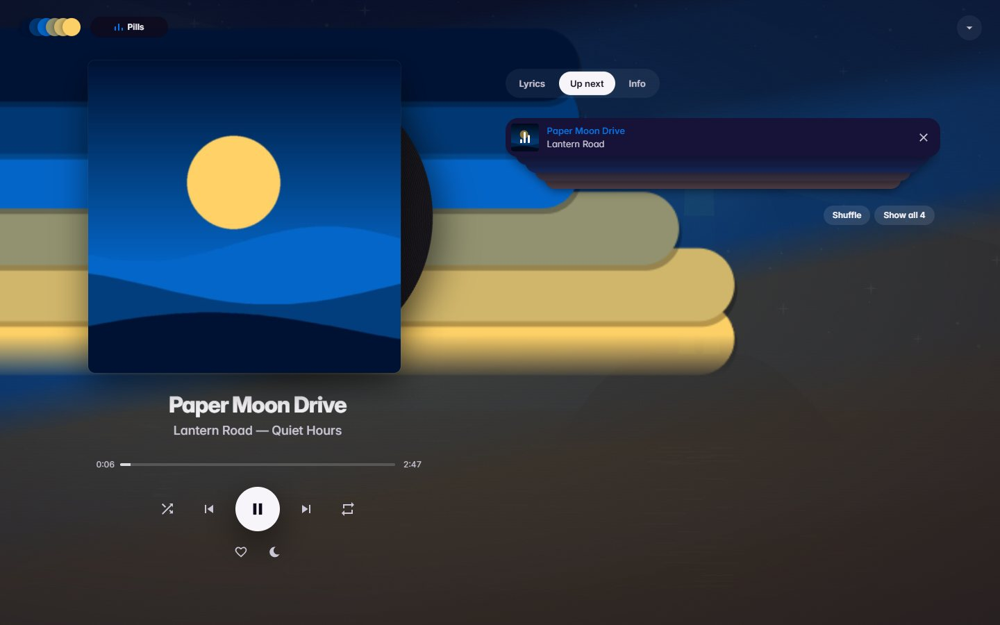
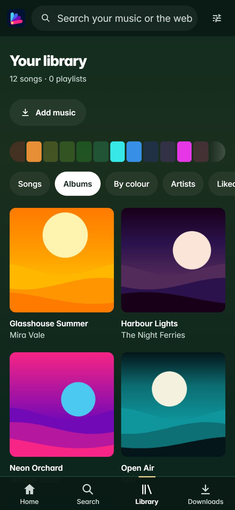
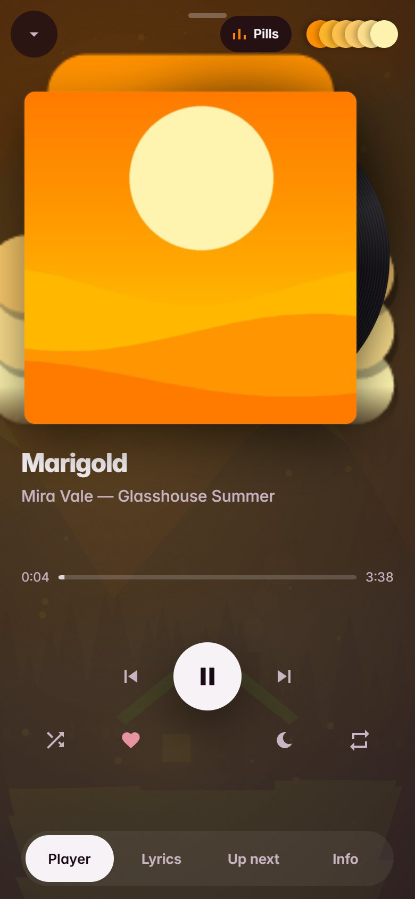
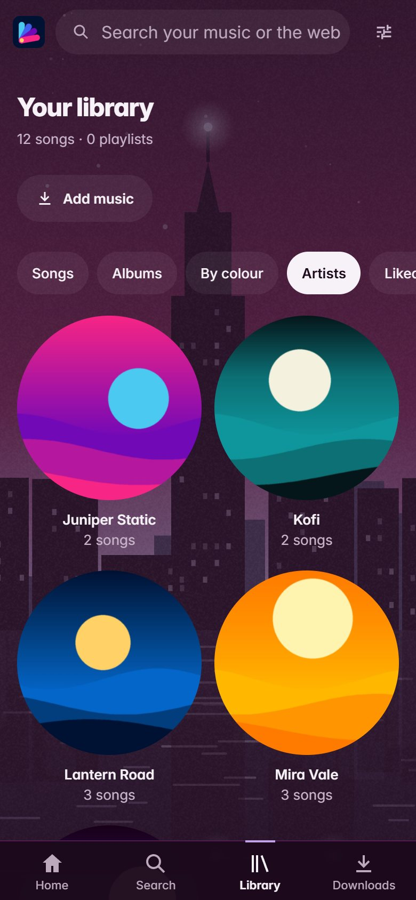
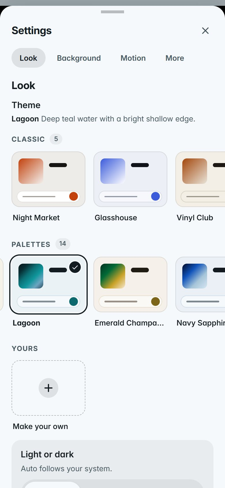
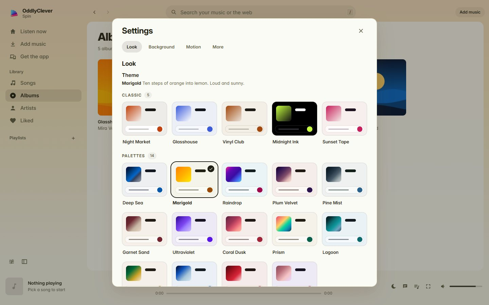
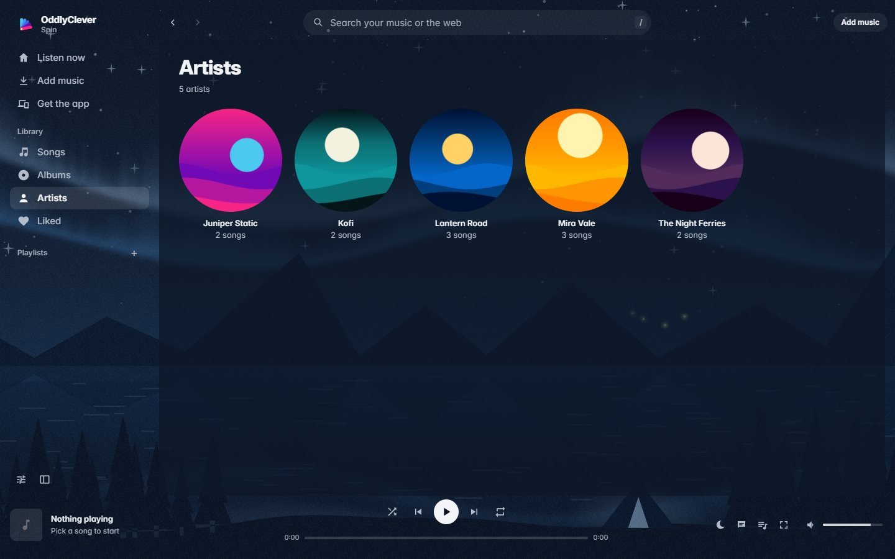

<p align="center"></p>

<p align="center"><b>A free music player and downloader I built for Windows and Android.</b><br>
No account, no ads, no servers of mine. Your music stays on your device.</p>

<p align="center">
  <a href="https://github.com/oddlyclevertools/oddlyclever-spin/releases/latest"><b>Download</b></a> ·
  <a href="https://oddlyclevertools.github.io/oddlyclever-spin/">Website</a> ·
  <a href="https://oddlyclevertools.github.io/oddlyclever-spin/#faq">FAQ</a> ·
  <a href="launch/PRIVACY.md">Privacy</a>
</p>

<p align="center"></p>

## What Spin is

I wanted a music app that felt as good as the big ones but kept my library on my own device, so I made one.
You search for a song, it plays straight away, and if you love it you keep it as a normal music file with the right title,
artist, album and a square cover. There's no account to make and nothing to pay.

| | | | |
|---|---|---|---|
|  |  |  |  |
| Your library | Now Playing | Live background | Themes |

 

*The songs and covers in these pictures are made up for the demo.*

## Features

- **One search for everything:** your own songs and new music in one box, with albums, artists and the best match on top. Paste a link to get a song, album or playlist.
- **Play straight away:** press any song and it streams. Press **Get** to keep it in your library with clean song info and cover art. **Get album** saves the songs you don't have yet.
- **Listen now:** quick picks, mixes made from your own library, top songs and new releases for your country.
- **Artist and album pages:** popular songs, albums, singles, "fans also like" and full track lists.
- **Library:** songs, albums, artists, liked songs, browse by colour, and playlists you can drag to reorder.
- **Player:** Up next, shuffle, repeat, synced lyrics (from the free LRCLIB library), a sleep timer that fades out, media keys, and it picks up where you left off.
- **19 looks:** five classic themes and fourteen palette themes, light and dark, or make your own from a photo or the cover that's playing.
- **Live backgrounds:** drawn landscapes that take your theme's colours and move gently behind the music. Motion can be Full, Calm or Off.
- **Your files stay yours:** songs are normal files in your Music folder. Other players see them, and uninstalling Spin never touches them.
- **Send to my phone:** the Windows app can hand the Android app to your phone over your home network with a QR code.
- **Keyboard:** Space, arrows, `/` to search, `Ctrl+K` for commands and `?` for every shortcut.

## Download

| | |
|---|---|
| **Windows 10 and 11** | `OddlyCleverSpin-Setup-<version>.exe` from [Releases](https://github.com/oddlyclevertools/oddlyclever-spin/releases/latest). It isn't code-signed yet, so SmartScreen may say "Windows protected your PC": click **More info**, then **Run anyway**. |
| **Android 7 and up** | `OddlyCleverSpin-<version>.apk` from [Releases](https://github.com/oddlyclevertools/oddlyclever-spin/releases/latest). Open it and allow your browser to install apps if Android asks. |
| **Android, auto-updating** | Add `https://github.com/oddlyclevertools/oddlyclever-spin` to [Obtainium](https://github.com/ImranR98/Obtainium) (tap **Add app** and paste the link). |
| **iPhone** | Not yet. Windows and Android come first. |

Each release has a `SHA256SUMS.txt`, so you can check your download (`Get-FileHash` in PowerShell, `sha256sum` elsewhere).
Spin isn't in the Play Store or Microsoft Store: their rules don't allow apps that save music from video sites.

## How it works

Spin finds songs in YouTube Music's catalogue and plays them or saves them on your device. Every request goes straight
from your device to YouTube on your own connection. There are no servers of mine in between, no account and no analytics,
so I never see what you search, play or save. The [privacy page](launch/PRIVACY.md) lists everything Spin talks to and when.

Under the hood it's a small local web app: a Python server (`server.py`) that runs only on your device, and a page (`web/`)
shown in a native window. On Windows that window is WebView2; on Android it's a WebView with Python running inside the app.
[yt-dlp](https://github.com/yt-dlp/yt-dlp) does the downloading and [ytmusicapi](https://github.com/sigma67/ytmusicapi) does the catalogue
lookups. When YouTube changes something, Spin updates its download engine by itself.

## Please download only music you have the right to

Spin is for your personal library: music you've bought, music that's free or Creative Commons (Internet Archive, Jamendo,
Free Music Archive, artists' own free downloads), or music the artist lets you save. Most services' terms don't allow downloading
everything else, so please respect artists and the terms of the services you use. Spin is not made by or connected to YouTube,
Google or any music service.

## Building from source

You need Windows, Git Bash and Python 3.12.

**Run it as a web app** (the quickest way to try a change):

```bash
python -m venv .venv
.venv/Scripts/pip install -r requirements.txt
.venv/Scripts/python server.py
```

Then open http://127.0.0.1:8790. You need ffmpeg on your `PATH` for saving songs. To use another music folder, pass it as the first argument.
Tests: `.venv/Scripts/python test_server.py`.

**Windows app:** you also need the .NET SDK 8 or later. `bash desktop/build.sh` writes the installer to `dist/`. See [desktop/README.md](desktop/README.md).

**Android app:** you need JDK 17, the Android SDK and your own signing key. `bash android/build.sh` writes the APK to `dist/`. See [android/README.md](android/README.md).

**Website:** the site in `site/` is plain HTML and CSS. `python tools/site_pages.py` rebuilds the privacy and licences pages from their Markdown.

**Releases:** `bash tools/release.sh <version>` builds both apps, names and checksums the files, writes the release notes and prints the publish command.

## Help and ideas

Something broken, or an idea? Open an [issue](https://github.com/oddlyclevertools/oddlyclever-spin/issues). The **Copy diagnostics**
button in Settings copies what I need to see. Please don't paste anything personal.

## Credits and licences

Spin is MIT licensed: see [LICENSE](LICENSE). It stands on a lot of open-source work, especially yt-dlp, ytmusicapi, Python, Chaquopy,
QuickJS-ng, FFmpeg (LGPL build), Inter, and pixelfx. Every component and its licence is listed in
[THIRD_PARTY_NOTICES.md](THIRD_PARTY_NOTICES.md). Thank you to everyone who made them.

The OddlyClever Spin name, logo and icon are mine. Please don't use them for your own builds or forks.
